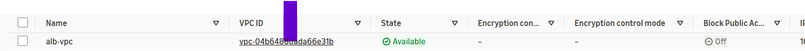
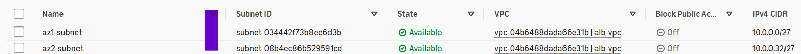
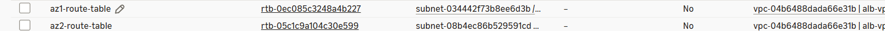
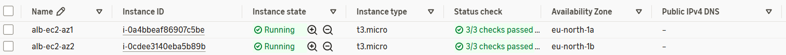
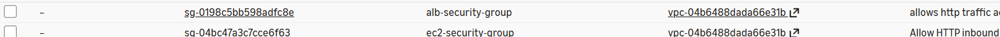
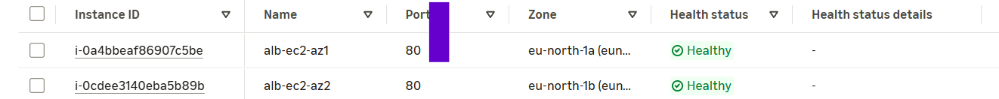
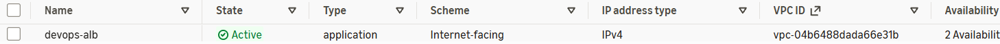

# AWS Multi-AZ Web Application Deployment

## Overview

This project demonstrates the deployment of a highly available web application infrastructure using Amazon Web Services (AWS).

Two Ubuntu EC2 instances running Nginx were deployed across separate Availability Zones and connected to an internet-facing Application Load Balancer (ALB).

The ALB distributes incoming HTTP requests between the EC2 instances using a target group with health checks, allowing traffic to be directed towards healthy instances.

The project provided hands-on experience with AWS networking, load balancing, security groups, EC2 user data, and troubleshooting.

## Architecture

The infrastructure consists of:

- One custom VPC (`10.0.0.0/26`)
- Two public subnets across separate Availability Zones
- An Internet Gateway for internet connectivity
- Route tables configured for VPC and internet traffic
- Two Ubuntu EC2 instances running Nginx
- An internet-facing Application Load Balancer
- A target group using HTTP health checks
- Security Groups controlling inbound and outbound traffic

## Implementation

### 1. VPC Configuration

Created a custom VPC with the CIDR block `10.0.0.0/26` to provide an isolated network environment for the application infrastructure.

### 2. Subnet Configuration

Created two subnets in separate Availability Zones to distribute the EC2 instances across different AWS infrastructure locations.

- AZ1: `10.0.0.0/27` in `eu-north-1a`
- AZ2: `10.0.0.32/27` in `eu-north-1b`

Both subnets were configured for public internet connectivity.

### 3. Route Table and Internet Gateway

Configured an Internet Gateway and route table to provide internet connectivity.

The route table includes:

- `10.0.0.0/26` → Local
- `0.0.0.0/0` → Internet Gateway

This allows instances with public IPv4 addresses to access external services, including Ubuntu package repositories.

### 4. EC2 Instance Deployment

Launched two Ubuntu EC2 instances in separate Availability Zones.

Each instance was configured using EC2 user data to automatically install Nginx and serve a unique HTML webpage.

The unique HTML responses make it possible to identify which EC2 instance handled a request.

### 5. Security Group Configuration

Configured Security Groups to control HTTP and SSH traffic.

The Application Load Balancer accepts incoming HTTP requests on port 80.

The EC2 instances allow the traffic required for application access and administration.

For a production deployment, EC2 HTTP access should be restricted to the ALB Security Group, with SSH restricted to trusted sources.

### 6. Target Group Configuration

Created a target group and registered both EC2 instances as targets on HTTP port 80.

Configured HTTP health checks to monitor application availability.

The target group uses the Round Robin load balancing algorithm, with stickiness disabled.

Only healthy, eligible targets receive normal application traffic.

### 7. Application Load Balancer

Deployed an internet-facing Application Load Balancer across two Availability Zones.

The ALB receives incoming HTTP requests and forwards them to the registered EC2 instances through the target group.

### 8. HTTP Listener

Configured an HTTP listener on port 80 to forward incoming requests to the target group.

## Testing and Validation

Validated the deployment by:

- Confirming both EC2 instances were running.
- Verifying the target group health checks.
- Accessing the application through the ALB DNS name.
- Testing responses from the two Nginx web servers.
- Investigating unhealthy targets and correcting network configuration issues.

## Troubleshooting and Lessons Learned

### Missing Internet Gateway Route

During deployment, one EC2 instance was unable to access external package repositories because its subnet did not have the required default route to the Internet Gateway.

This prevented Nginx from installing successfully.

The issue was resolved by configuring the route table with:

`0.0.0.0/0 → Internet Gateway`

### EC2 User Data

Both instances initially served identical HTML content, making it appear that the ALB was only routing requests to one instance.

This highlighted that EC2 user data normally executes during the first boot and modifying the user data configuration does not automatically update an already running application.

### EC2 Status Checks vs ALB Health Checks

An EC2 instance can be running and pass its instance status checks while failing ALB health checks.

EC2 status checks monitor instance and infrastructure health, whereas ALB health checks validate application responsiveness.

## Key Takeaways

This project strengthened my understanding of:

- AWS VPC networking and CIDR allocation
- Public subnets and Internet Gateway routing
- Deploying EC2 instances across Availability Zones
- Automating application setup using EC2 user data
- Configuring Security Groups
- Application Load Balancers and target groups
- HTTP listeners and health checks
- Troubleshooting network and application connectivity

## Future Improvements

- Restrict EC2 HTTP access to the ALB Security Group
- Add HTTPS using AWS Certificate Manager
- Deploy application instances in private subnets
- Introduce an Auto Scaling Group
- Provision the infrastructure using Terraform
- Configure CloudWatch monitoring and alarms
