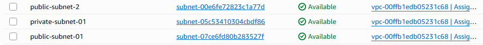
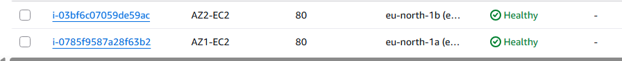

# AWS Application Load Balancer & EC2 Project

## Project Overview

This project demonstrates the deployment and configuration of an AWS Application Load Balancer (ALB) to distribute incoming HTTP traffic across two EC2 instances deployed in separate Availability Zones.

The objective was to gain hands-on experience with AWS load balancing, target groups, health checks, and high availability by building an infrastructure environment capable of distributing incoming requests across multiple web servers.

The infrastructure was provisioned manually using the AWS Management Console to develop a practical understanding of how Application Load Balancers operate and how they improve application availability and fault tolerance.

A key aspect of this project was configuring **one Application Load Balancer across two Availability Zones**, with an EC2 instance deployed in each zone. Both instances hosted web pages displaying different responses, allowing traffic distribution to be tested and verified.

## Architecture

The infrastructure was deployed in the AWS **eu-north-1 (Stockholm)** Region within a custom VPC containing two public and two private subnets.

A single internet-facing Application Load Balancer was configured across two Availability Zones, receiving incoming HTTP requests on port 80 and forwarding them to healthy EC2 instances registered within a target group.

The EC2 instances were deployed across:

- **eu-north-1a:** AZ1-EC2 (Server 1)
- **eu-north-1b:** AZ2-EC2 (Server 2)

This architecture improves application availability by allowing the ALB to continue directing traffic to a healthy instance if another becomes unhealthy.

### Network Components

- **VPC:** Provides an isolated virtual network for the infrastructure.
- **Public Subnets:** Two public subnets configured within the VPC to support the internet-facing ALB.
- **Private Subnets:** Two private subnets created within the VPC.
- **Application Load Balancer (ALB):** Distributes incoming HTTP traffic across healthy EC2 instances in two Availability Zones.
- **EC2 Instances:** Two web servers deployed in separate Availability Zones, each serving a different response.
- **Target Group:** Contains both EC2 instances as registered targets.
- **HTTP Listener:** Listens for incoming HTTP requests on port 80 and forwards them to the target group.
- **Health Checks:** Monitor the availability of EC2 instances to ensure traffic is forwarded only to healthy targets.
- **Security Groups:** Control inbound and outbound network traffic between the ALB and EC2 instances.

### Architecture Diagram

## Implementation

### 1. VPC and Subnet Configuration

Created a custom Virtual Private Cloud (VPC) in the AWS `eu-north-1` (Stockholm) Region to provide an isolated networking environment for the infrastructure.

The VPC contained four subnets distributed across two Availability Zones:

- **Public Subnet 1:** Hosted the internet-facing Application Load Balancer in `eu-north-1a`.
- **Public Subnet 2:** Hosted the Application Load Balancer in `eu-north-1b`.
- **Private Subnet 1:** Hosted the first EC2 web server.
- **Private Subnet 2:** Hosted the second EC2 web server.

The public subnets provided the internet-facing entry point, while the private subnets hosted the backend application servers.

This design separated public-facing infrastructure from internal application resources and provided a foundation for improved security and availability.

#### VPC and Subnet Configuration

---

### 2. EC2 Instance Deployment

Deployed two Amazon EC2 instances in separate Availability Zones to act as backend web servers.

Each instance was configured with NGINX to serve a simple web page displaying a unique response.

The instances were deployed as follows:

- **AZ1-EC2:** Deployed in `eu-north-1a`, within a private subnet, serving "Hello from Server 1".
- **AZ2-EC2:** Deployed in `eu-north-1b`, within a private subnet, serving "Hello from Server 2".

Deploying the instances across separate Availability Zones reduced dependency on a single Availability Zone.

Both instances were subsequently registered within the Application Load Balancer's target group.

#### EC2 Instance Configuration

---

### 3. Application Load Balancer Configuration

Created a single internet-facing Application Load Balancer (ALB) to distribute incoming HTTP traffic across the two EC2 instances.

The ALB was configured with the following settings:

- **Name:** `EC2-ALB`
- **Type:** Application Load Balancer
- **Scheme:** Internet-facing
- **IP Address Type:** IPv4
- **Region:** `eu-north-1` (Stockholm)
- **Availability Zones:** `eu-north-1a` and `eu-north-1b`
- **Subnets:** Two public subnets

The Application Load Balancer operates at Layer 7 of the OSI model, allowing it to process HTTP requests and forward them to registered backend targets.

By configuring one ALB across two Availability Zones, incoming requests could be distributed between EC2 instances deployed in separate locations.

This improved the infrastructure's resilience by reducing reliance on a single backend server.

#### Application Load Balancer Configuration

---

### 4. Security Group Configuration

Configured separate AWS Security Groups for the Application Load Balancer and backend EC2 instances.

Security Groups act as stateful virtual firewalls that control permitted inbound and outbound traffic.

#### Application Load Balancer Security Group

The ALB security group was configured to:

- Allow inbound HTTP traffic on port 80.
- Accept incoming HTTP requests from `0.0.0.0/0`.
- Permit outbound communication to the backend EC2 instances.

This allowed external clients to access the application through the ALB's public DNS endpoint.

#### EC2 Security Group

The backend EC2 security group was configured to:

- Allow inbound HTTP traffic on port 80.
- Use the ALB security group as the source for the HTTP rule.
- Restrict direct HTTP access from the public internet.

Rather than allowing HTTP requests from any IP address, referencing the ALB security group ensured that the backend instances could receive application traffic through the load balancer.

This reinforced the separation between the public-facing ALB and the private application servers.

---

### 5. Target Group and Health Checks

Created a target group named `EC2` to manage the backend web servers receiving traffic from the Application Load Balancer.

The target group was configured with:

- **Target Type:** EC2 instances
- **Protocol:** HTTP
- **Port:** 80
- **Registered Targets:** 2
- **Availability Zones:** 2
- **Target Health:** Both instances healthy

Both EC2 instances were registered as targets.

The ALB uses health checks to determine whether registered instances are available to receive traffic.

When a target becomes unhealthy, the ALB can stop forwarding new requests to that target while healthy targets remain available.

After resolving the initial security group configuration issue, both EC2 instances successfully passed their health checks.

#### Target Group Health

---

### 6. HTTP Listener Configuration

Configured an HTTP listener on the Application Load Balancer to accept incoming client requests.

The listener was configured with the following settings:

- **Protocol:** HTTP
- **Port:** 80
- **Default Action:** Forward requests to the `EC2` target group
- **Traffic Distribution:** 100% forwarded to the target group
- **Target Group Stickiness:** Disabled

When a client accessed the ALB's DNS endpoint, the HTTP listener received the request and forwarded it to the target group.

The ALB then selected an eligible healthy EC2 instance to process the request.

#### HTTP Listener Configuration

---

### 7. Testing Traffic Distribution

After configuring the ALB, target group, listener and security groups, I tested the infrastructure by accessing the ALB's public DNS endpoint through a web browser.

Each EC2 instance hosted a web page displaying a different response, allowing me to identify which server processed each request.

#### Server 1 Response

The browser displayed:

**Hello from Server 1**

#### Server 2 Response

The browser also displayed:

**Hello from Server 2**

Both responses were received through the same Application Load Balancer DNS endpoint.

This confirmed that:

- The Application Load Balancer was publicly accessible.
- The HTTP listener successfully forwarded incoming requests.
- Both EC2 instances were registered within the target group.
- Both instances passed their health checks.
- HTTP requests successfully reached both backend servers.
- Traffic was distributed across instances in separate Availability Zones.

The successful responses demonstrated that the ALB was functioning as intended and could route traffic to both backend web servers.

---

## Challenges and Troubleshooting

### 1. EC2 Instances Failing Health Checks

One of the main issues encountered during the project was that the EC2 instances initially failed the Application Load Balancer's health checks.

#### Problem

The EC2 security group initially allowed SSH traffic but did not include an inbound HTTP rule on port 80.

As a result, the Application Load Balancer could not successfully establish the required HTTP connections to the backend instances.

This caused the targets to fail their health checks.

#### Resolution

To resolve the issue:

1. Reviewed the security group rules associated with the EC2 instances.
2. Identified that inbound HTTP traffic on port 80 was not permitted.
3. Added an inbound HTTP rule on port 80.
4. Configured the source as the Application Load Balancer's security group.
5. Rechecked the target group and verified that both EC2 instances became healthy.

#### Key Learning

This demonstrated how Security Groups can affect communication between AWS resources.

I learned that a correctly configured load balancer and target group are not sufficient if the backend instances do not permit traffic on the required application port.

I also gained a better understanding of referencing security groups rather than allowing unrestricted inbound traffic from the internet.

### 2. Public Subnet Routing Configuration

During the ALB configuration, I also reviewed the routing configuration of the public subnets.

An internet-facing Application Load Balancer requires appropriate public subnet routing, including a route to an Internet Gateway.

I worked through the subnet routing configuration to ensure that the ALB could operate across the selected Availability Zones.

This reinforced my understanding of the relationship between VPC route tables, Internet Gateways and public subnets.

---

## Key Learnings

Through this project, I gained practical experience in:

- **Application Load Balancers:** Understanding how AWS distributes incoming HTTP traffic across multiple backend instances.
- **Multi-AZ Architecture:** Deploying EC2 instances in separate Availability Zones to improve infrastructure resilience.
- **Public and Private Subnets:** Separating internet-facing infrastructure from internal application servers.
- **Security Groups:** Configuring inbound rules and referencing other security groups to control communication between AWS resources.
- **Target Groups:** Registering backend EC2 instances and managing traffic destinations.
- **Health Checks:** Understanding how ALBs monitor backend availability and how network configuration can affect target health.
- **HTTP Listeners:** Configuring listener rules to forward incoming requests to the correct target group.
- **NGINX:** Hosting simple web pages on EC2 instances to validate traffic distribution.
- **Troubleshooting:** Identifying and resolving connectivity problems caused by incorrect security group rules.
- **Infrastructure Validation:** Using AWS Console information and browser testing to verify successful deployment.

---

## Future Improvements

### 1. Infrastructure as Code Using Terraform

Recreate the infrastructure using Terraform to automate the provisioning of the VPC, subnets, security groups, EC2 instances, Application Load Balancer and target groups.

This would improve deployment consistency, repeatability and maintainability.

### 2. HTTPS and TLS Encryption

Configure an HTTPS listener on port 443 using AWS Certificate Manager (ACM).

This would encrypt communication between clients and the ALB and allow HTTP requests to be redirected to HTTPS.

### 3. EC2 Auto Scaling

Introduce an EC2 Auto Scaling Group to automatically manage the number of backend instances based on application demand.

This would improve scalability and reduce manual infrastructure management.

### 4. Monitoring and Logging

Integrate Amazon CloudWatch metrics, logs and alarms to monitor:

- Application Load Balancer request counts.
- Target group health.
- HTTP error rates.
- EC2 instance performance.

---

## Conclusion

This project provided hands-on experience in deploying and configuring an AWS Application Load Balancer across two Availability Zones.

By deploying two NGINX web servers in private subnets, configuring an internet-facing ALB, registering both instances within a target group and implementing the required security group rules, I developed a practical understanding of AWS load balancing and multi-AZ infrastructure.

A key challenge was troubleshooting failed target group health checks caused by missing HTTP permissions in the EC2 security group. Resolving this issue strengthened my understanding of AWS networking, security groups and communication between cloud resources.

Successfully receiving responses from both backend servers through a single ALB DNS endpoint demonstrated that traffic distribution was functioning as intended.

Overall, this project strengthened my practical knowledge of AWS networking, load balancing, security and infrastructure troubleshooting, providing a foundation for future projects involving Terraform, Auto Scaling and CI/CD automation.

